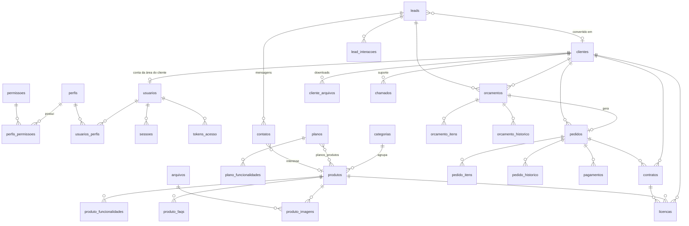

# Banco de dados (PostgreSQL)

Estrutura definida em [`database/migrations/001_esquema_inicial.sql`](../database/migrations/001_esquema_inicial.sql). Convenções:

- Chaves primárias `SERIAL`/`BIGSERIAL`; nomes em português, no singular para colunas e plural para tabelas.
- Valores monetários em `NUMERIC(14,2)`; cálculos feitos em centavos inteiros (`BigInt`) na aplicação.
- Datas/horas em `TIMESTAMPTZ` (UTC); datas de negócio (validade, vencimento, vigência) em `DATE`.
- `criado_em` / `atualizado_em` com gatilho `fn_atualizar_timestamp`.
- Restrições `CHECK` para status, valores não negativos, descontos ≤ subtotal, datas coerentes.
- Unicidade: e-mails (case-insensitive) de usuários e clientes, slugs, números de documentos, identificadores de licença.
- Exclusão lógica/arquivamento onde há histórico: produtos (`arquivado`), planos (`ativo=false`), clientes (`anonimizado_em`).

## Diagrama de relacionamentos

## Tabelas

| Grupo | Tabela | Finalidade |
| --- | --- | --- |
| Acesso | `perfis`, `permissoes`, `perfis_permissoes` | RBAC: perfis (administrador, gerente comercial, editor de conteúdo, consulta) e permissões granulares |
| | `usuarios`, `usuarios_perfis` | Usuários da equipe (`tipo='equipe'`) e contas de clientes (`tipo='cliente'`, com `cliente_id`). Senhas em Argon2id; contagem de falhas e bloqueio temporário |
| | `sessoes` | Sessões com hash SHA-256 do token, token CSRF, expiração absoluta e por inatividade, revogação |
| | `tokens_acesso` | Convites e redefinição de senha (hash, uso único, expiração) |
| Catálogo | `categorias`, `produtos` | Produto com status comercial, publicação, destaque, demonstração, SEO e ordenação. Regra: produto arquivado não pode estar publicado |
| | `produto_funcionalidades` | Funcionalidades e benefícios (`tipo`) |
| | `produto_imagens`, `produto_faqs` | Galeria (arquivo da biblioteca ou imagem estática) e perguntas específicas |
| | `servicos` | Serviços com benefícios (`TEXT[]`), preço opcional e status |
| | `planos`, `plano_funcionalidades`, `planos_produtos` | Modelos comerciais; preço obrigatório exceto em "sob orçamento"/"personalizado" |
| Comercial | `leads`, `contatos`, `lead_interacoes` | Interessado (lead), cada mensagem recebida (com consentimento e hash do IP) e histórico de atendimento |
| | `clientes` | Cadastro mínimo; documento só quando necessário; anonimização LGPD |
| | `orcamentos`, `orcamento_itens`, `orcamento_historico` | Proposta com numeração `ORC-AAAA-NNNN`, itens, totais, validade, condições e trilha de alterações |
| | `pedidos`, `pedido_itens`, `pedido_historico` | Pedido `PED-AAAA-NNNN`, situação do pedido e situação de pagamento separadas; quem autorizou desconto |
| | `pagamentos`, `eventos_pagamento` | Pagamentos (manual ou gateway) e eventos de webhook (idempotência) |
| | `contratos`, `licencas` | Contratos `CTR-AAAA-NNNN` com documento anexado e licenças administrativas `LIC-XXXXXXXXXX` |
| | `cliente_arquivos`, `chamados` | Downloads autorizados e suporte |
| | `sequencias_documentos` | Numeração anual dos documentos |
| Conteúdo | `paginas`, `conteudos`, `faqs` | Páginas institucionais/jurídicas (Markdown), blocos de texto/imagem por chave, FAQ |
| | `arquivos` | Biblioteca de mídia e documentos privados, com origem e licença |
| Sistema | `configuracoes` | Pares chave/valor (JSONB), com indicação do que é público |
| | `modelos_email`, `emails_registro` | Modelos editáveis e registro de envios (enviado / não configurado / falhou) |
| | `notificacoes`, `notificacoes_lidas` | Notificações internas por usuário ou por permissão |
| | `auditoria` | Quem fez o quê, quando e em qual entidade (sem senhas/tokens) |
| | `visualizacoes_produtos` | Contagem diária agregada por produto, sem dados pessoais |
| | `solicitacoes_titulares` | Solicitações LGPD |
| | `schema_migrations` | Controle das migrations aplicadas |

## Transações

Operações que envolvem várias tabelas usam `withTransaction` (`backend/src/database/pool.js`): criação/edição de produtos e itens, orçamentos com itens e histórico, geração de pedido a partir de orçamento, pagamentos com recálculo da situação, conversão de leads, anonimização, alteração de permissões e o envio de formulários públicos (lead + contato + orçamento + notificação).

## Índices principais

Produtos publicados por ordem, busca textual (GIN `to_tsvector('portuguese', ...)`), e-mails em minúsculas, leads por status/data, orçamentos por status/cliente, pedidos por cliente/data, auditoria por data e por entidade, sessões ativas por usuário.

## Novas migrations

Crie um arquivo `database/migrations/NNN_descricao.sql` com número sequencial (ex.: `002_campos_extras.sql`) e rode `npm run db:migrate`. Cada migration roda em transação e é registrada em `schema_migrations`; um bloqueio consultivo impede execuções simultâneas. Nunca altere uma migration já aplicada em produção — crie outra.
