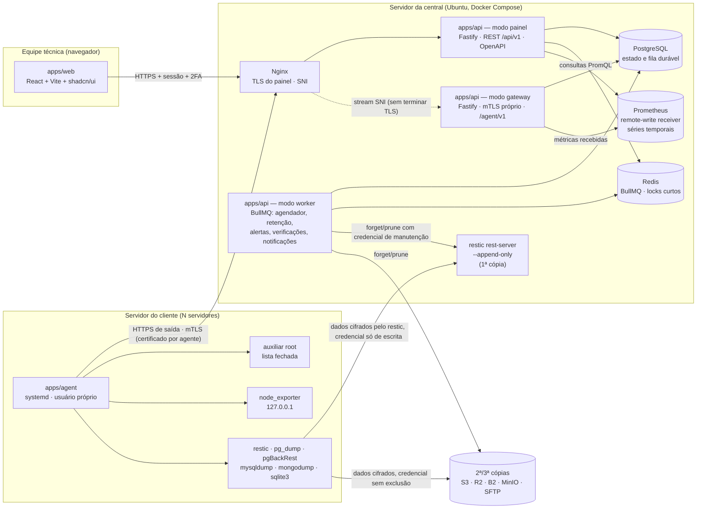
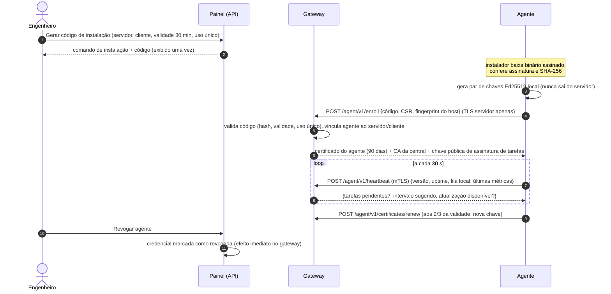
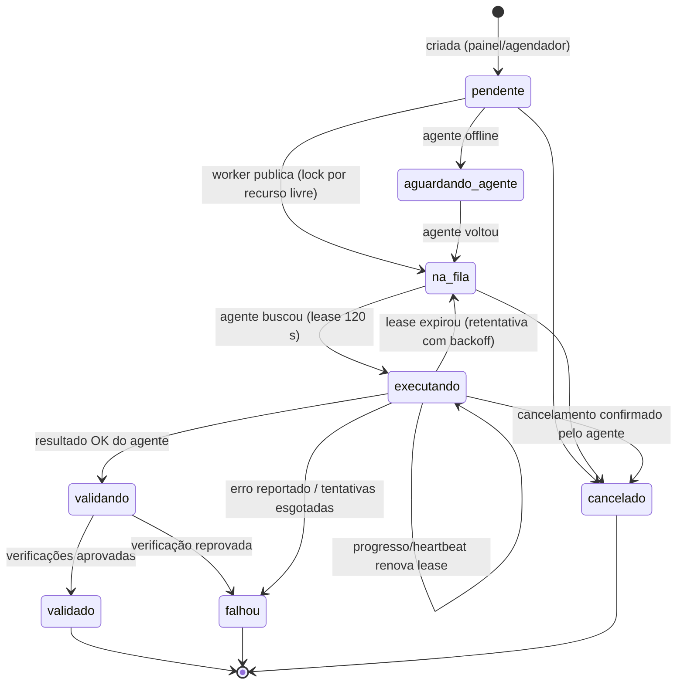
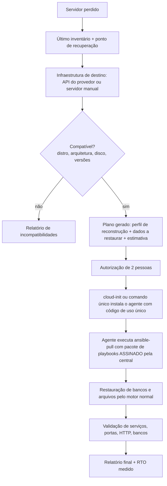

# 01 — Arquitetura

## 1. Componentes

Um único código (`apps/api`) roda em **três processos**, cada um com o mínimo de rede e privilégio:

| Processo | Expõe | Faz |
| --- | --- | --- |
| **painel** | `/api/v1` (atrás do Nginx, rede interna) | Autenticação, CRUD, consultas, pedidos de operação. Nunca fala com agentes diretamente |
| **gateway** | `/agent/v1` com **mTLS terminado no próprio Node** (o Nginx só repassa pelo SNI, sem confiar em cabeçalhos) | Registro, heartbeat, entrega de tarefas, recebimento de resultados, métricas e inventário |
| **worker** | nada | Agendamento, distribuição, timeouts, retentativas, retenção/prune, verificações, alertas, notificações, backup do próprio banco |

## 2. Princípios de projeto

1. **PostgreSQL é a fonte da verdade; Redis é acelerador.** Toda tarefa existe primeiro em
   `agent_task_queue` (padrão *outbox*). O BullMQ agenda e distribui; se o Redis cair ou for perdido,
   o worker reconstrói as filas a partir do banco ao iniciar. Nada se perde, no máximo atrasa.
2. **O agente inicia toda comunicação** (HTTPS de saída, long-poll). Nenhuma porta administrativa é
   aberta nos clientes.
3. **Nenhum comando arbitrário.** O painel escolhe uma operação de um catálogo versionado
   (`packages/contracts`), com parâmetros validados por esquema no painel, no gateway, no agente e no
   auxiliar root.
4. **Uma tarefa só termina com o resultado do agente** — enviar não é concluir. Backups só são
   **validados** depois das verificações próprias de cada tipo.
5. **Agentes não apagam backups.** Credenciais de escrita dos agentes são *append-only*/sem exclusão; a
   retenção (forget/prune) é feita pela central com credencial de manutenção separada. Um servidor de
   cliente comprometido não consegue destruir o próprio histórico.
6. **Carga leve nos clientes.** Coleta a cada 60 s por padrão, backup com `nice`/`ionice`, limite de
   banda e janelas de execução por política.

## 3. Ciclo de vida do agente

- **Identidade individual**: cada agente tem chave privada própria e certificado emitido pela CA
  interna da central. Não existe token global. O gateway confere a cada requisição o *serial* do
  certificado contra `agent_credentials` (cache de 30 s), então a revogação vale em segundos.
- **Servidor cadastrado manualmente** pode existir sem agente (status "sem agente"); o código de
  instalação é gerado para ele. **Provisionamento**: o mesmo código pode ser injetado via cloud-init.

## 4. Fila de tarefas e protocolo

O estado **Restaurando** é o equivalente de *executando* para tarefas de restauração; **Concluído**
é usado por operações sem verificação (ex.: coleta de inventário).

- **Entrega**: o agente faz `GET /agent/v1/tasks?wait=25` (long-poll). O gateway reserva a tarefa com
  `UPDATE … WHERE status='na_fila' … FOR UPDATE SKIP LOCKED`, grava `lease_until` e `attempt`.
- **Assinatura**: cada tarefa vai assinada (Ed25519) pela chave de tarefas da central, com
  `agent_id`, `task_id`, `expires_at` e hash dos parâmetros. O agente recusa tarefa não assinada,
  vencida, de outro agente ou repetida — proteção extra mesmo se o gateway for comprometido.
- **Locks**: no máximo uma tarefa ativa por recurso (`lock_key`, ex.: `db:42`, `repo:7`), garantido
  por índice único parcial no PostgreSQL. O Redis só faz locks curtos de agendamento.
- **Duplicidade**: `idempotency_key` única (ex.: `policy:5:2026-11-07T03:00Z`); o agendador pode
  rodar duas vezes sem criar dois backups. O agente guarda as tarefas já executadas e reenvia o mesmo
  resultado se a central perguntar de novo.
- **Retentativas**: backoff exponencial com jitter (1, 2, 4, 8 min… até o limite da política);
  falha definitiva gera alerta.
- **Fila local do agente**: resultados, logs e métricas ficam num SQLite local (journal WAL) até a
  central confirmar recebimento (ack). Tarefas recebidas antes de cair continuam após reinício quando
  forem idempotentes; as demais são reportadas como "interrompida" para a central decidir.
- **Reinício da central**: ao iniciar, o worker (a) republica tarefas `pendente/na_fila` no BullMQ,
  (b) devolve à fila tarefas com lease vencido, (c) recalcula os próximos agendamentos.

## 5. Motor de backup

Cada **política** gera **jobs** (o que proteger) que geram **execuções** (cada tentativa), que geram
**snapshots** (o que ficou armazenado em cada destino) e **verificações**.

| Alvo | Ferramenta | Consistência | Verificação mínima para "validado" |
| --- | --- | --- | --- |
| Arquivos, diretórios, configurações, aplicação | **restic** (dedup, cifrado, incremental por natureza) | arquivos de banco ativos são **excluídos** automaticamente quando o banco está cadastrado | código de saída 0 sem erros na saída JSON; snapshot listado no repositório; `restic check` periódico com `--read-data-subset` |
| PostgreSQL lógico | `pg_dump -Fc` → stream para restic (`--stdin`) | transação única | `pg_restore --list` do dump; tamanho > 0; hash registrado |
| PostgreSQL físico / PITR | **pgBackRest** (full/diff/incr, WAL) | archive WAL | `pgbackrest check` e `info`; teste de restauração periódico |
| MySQL/MariaDB lógico | `mysqldump`/`mariadb-dump --single-transaction --routines --events` | transação (InnoDB) | dump termina com marcador de conclusão; restauração de teste periódica |
| MySQL/MariaDB físico | Percona XtraBackup / Mariabackup (conforme versão) | ferramenta nativa | `--prepare` bem-sucedido |
| SQLite | API de backup online (`sqlite3 .backup` / `VACUUM INTO`) respeitando WAL | cópia consistente | `PRAGMA integrity_check` = ok |
| MongoDB | `mongodump --archive --gzip` (`--oplog` em replica set) | ponto consistente quando há oplog | `mongorestore --dryRun` |

Saída de erro e código de cada ferramenta são registrados e interpretados — nenhum aviso é
ignorado. Ferramentas ausentes ou de versão incompatível aparecem como erro claro no inventário.

**Políticas** definem: alvo(s), tipo, cron/intervalo e dias, janela, retenção (por hora/dia/semana/
mês/ano), destinos (ordem e quantidade de cópias), compressão, criptografia (sempre ligada), regras de
verificação, notificações e limites (CPU `nice`, I/O `ionice`, banda, tempo máximo).

**Retenção e dependências**: restic usa `forget` com a política + `prune` (snapshots são
independentes entre si). pgBackRest tem cadeias full → diff → incr: a central modela
`depends_on_snapshot_id` e só permite remover um conjunto quando nenhum outro depende dele. Snapshots
podem receber **retenção legal** (*hold*), que bloqueia qualquer exclusão.

## 6. Armazenamento

- Cada destino é um **repositório restic** (ou repo pgBackRest) por servidor × destino, com senha
  própria gerada pela central e guardada cifrada.
- Destinos suportados: diretório local da central via **rest-server `--append-only`**, NAS (SFTP ou
  rest-server), SFTP, S3 e compatíveis (Cloudflare R2, Backblaze B2, MinIO).
- **Imutabilidade**: rest-server append-only; S3/B2/MinIO com *Object Lock* quando o bucket permitir;
  chaves dos agentes sem permissão de exclusão.
- **Capacidade e uso**: o worker coleta tamanho por repositório (`restic stats`) e o espaço do
  destino quando disponível, gravando em `backup_storage_usage` (histórico diário).

## 7. Restauração

Assistente em 11 passos (seleção → integridade → destino → resumo de consequências → confirmação →
execução → validação → auditoria). Regras:

- Destino padrão: **ambiente temporário** (diretório isolado ou banco com nome novo, ex.
  `cli_app_restore_20261107`), sem tocar na produção.
- Restauração **por cima** da produção exige: permissão `restaurar.producao`, confirmação digitando o
  nome do recurso, e **aprovação de um segundo usuário** (quem solicitou ≠ quem autorizou). Antes de
  sobrescrever, o agente faz um backup de segurança do estado atual.
- Escrita no servidor passa pelo auxiliar root, que só aceita caminhos dentro dos diretórios
  cadastrados da aplicação ou do destino temporário.

## 8. Monitoramento

- O agente lê o `node_exporter` local (escutando só em `127.0.0.1`) e métricas dos bancos (conexões,
  tamanho, replicação) em intervalos configuráveis (padrão 60 s) e envia em lote ao gateway, que
  grava no **Prometheus** via *remote write*. Assim não é preciso abrir porta de scrape nos clientes.
- Retenção no Prometheus: 35 dias (para consultas de 1 h, 24 h, 7 d e 30 d); agregados diários de
  longo prazo vão para o PostgreSQL. Métricas de alta frequência **não** ficam no banco transacional.
- `monitoring_metrics` no PostgreSQL guarda só o **último valor** por servidor (para o dashboard e
  regras simples) e os agregados diários.

## 9. Alertas

Regras avaliadas pelo worker (backup falhou/atrasado, agente sem heartbeat, disco > 80%/> 90%, etc.)
com limiar, duração mínima ("por 10 min"), severidade (informativo, atenção, alto, crítico) e
supressão configurável. Deduplicação por `fingerprint` (regra + recurso): um alerta aberto é
atualizado, não duplicado. Ciclo: aberto → reconhecido → resolvido (automático quando a condição
some). Canais: e-mail (fase 6) e WhatsApp (interface pronta, provedor a definir).

## 10. Disaster Recovery

- **Inventário** coletado pelo agente (pacotes, serviços, usuários técnicos, grupos, diretórios,
  partições, rede, firewall, Nginx, certificados, Docker, cron, aplicações, bancos), versionado em
  `server_inventory`. Segredos encontrados (chaves, senhas) nunca entram em texto puro.
- **Perfis de reconstrução** = papéis Ansible versionados (`infrastructure/ansible/roles`) + variáveis
  por servidor. Executados com `ansible-pull` **no próprio servidor novo**, pelo agente, a partir de um
  pacote assinado — sem SSH de entrada.
- **Três modalidades**: recuperação de arquivos, reconstrução de servidor, recuperação completa de
  ambiente (vários servidores com ordem e dependências).
- **Sem API do provedor**: o plano gera um roteiro manual (criar VPS com X CPU/Y GB/Z disco, executar
  o comando de instalação) e o fluxo continua a partir do agente.
- **RPO/RTO** por cliente/aplicação: RPO atendido se `intervalo da política + duração p95 ≤ RPO` e o
  último backup validado está dentro do RPO; RTO estimado pela duração do último teste de recuperação.
- **Testes de desastre** periódicos só em ambiente isolado (servidor descartável ou contêiner na
  central), nunca na produção; o resultado alimenta o RTO medido.
