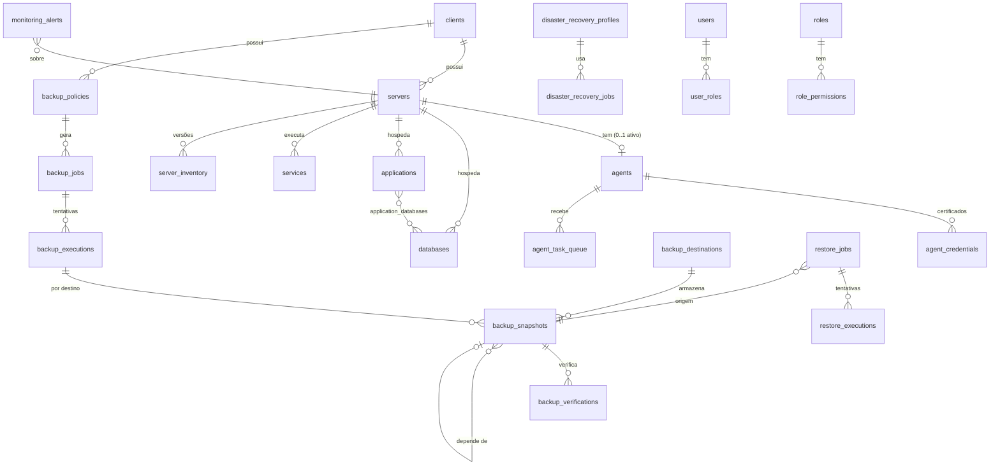

# 02 — Modelo de dados (PostgreSQL 16)

Convenções: chave `id bigint generated always as identity` (e `public_id uuid` para URLs e para o
agente); `created_at`/`updated_at timestamptz`; estados como `text` com `CHECK` (fácil de evoluir em
migrations); migrations versionadas e só aditivas (`database/migrations/NNNN_*.sql`).

## 1. Isolamento entre clientes

Toda tabela de recurso de cliente tem `client_id NOT NULL`. Relações entre recursos usam **chave
estrangeira composta** `(id, client_id)`, de modo que o banco recusa, por exemplo, um backup do cliente
A apontando para um servidor do cliente B. Como segunda barreira, **Row Level Security** filtra por
`current_setting('app.client_scope')`, definido em cada transação a partir do usuário (usuários podem
ter acesso a todos os clientes ou só a alguns — `user_client_scopes`).

## 2. Entidades

### Acesso
| Tabela | Colunas principais | Regras |
| --- | --- | --- |
| `users` | email (único, citext), name, password_hash (Argon2id), totp_secret_enc, totp_enabled, failed_logins, locked_until, status, last_login_at | 2FA obrigatório para todos após o primeiro acesso |
| `roles` / `permissions` / `role_permissions` / `user_roles` | code, description, group | perfis do sistema: `admin`, `infra_engineer`, `backup_operator`, `auditor` |
| `user_client_scopes` | user_id, client_id | ausente = todos os clientes |
| `sessions` | id (hash do token), user_id, ip, user_agent, created_at, last_seen_at, expires_at, revoked_at, mfa_verified_at | sessão no servidor; revogável |

### Clientes e infraestrutura
| Tabela | Colunas principais | Regras |
| --- | --- | --- |
| `clients` | legal_name, trade_name, cnpj (opcional, validado, único quando presente), tech_contact, email, phone, notes, status (`ativo`, `suspenso`, `encerrado`), rpo_minutes, rto_minutes, archived_at | exclusão lógica (histórico preservado) |
| `servers` | client_id, name, hostname, ip_addresses inet[], os_name, os_version, arch, cpu_model, cpu_cores, memory_bytes, disks jsonb, storage_bytes, uptime_s, last_seen_at, connection_status (`sem_agente`, `online`, `offline`, `degradado`), provider, provider_ref, archived_at | `unique(client_id, name)` |
| `server_inventory` | server_id, client_id, collected_at, version, data jsonb, secrets_enc bytea, hash | um registro por mudança (deduplicado pelo hash) |
| `agents` | server_id (único entre ativos), client_id, public_id, version, platform, status (`provisionando`, `ativo`, `revogado`), last_heartbeat_at, local_queue_size, update_channel | |
| `agent_enrollment_codes` | server_id, code_hash, expires_at, used_at, created_by | uso único, validade curta |
| `agent_credentials` | agent_id, cert_serial (único), cert_fingerprint, public_key, not_before, not_after, revoked_at, revoked_reason | rotação: várias linhas por agente, só uma não revogada e válida por vez |
| `services` | server_id, client_id, unit_name, kind (`systemd`, `docker`), monitored, last_state, last_checked_at | |

### Bancos e aplicações
| Tabela | Colunas principais | Regras |
| --- | --- | --- |
| `databases` | client_id, server_id, engine (`postgresql`, `mysql`, `mariadb`, `sqlite`, `mongodb`, `sqlserver`), version, instance_name, db_name, host, port, socket_path, file_path (SQLite), tech_user, credential_id, size_bytes, last_backup_at, policy_id, connection_status, last_test_at, last_test_error | `unique(server_id, engine, instance_name, db_name)`; `sqlserver` marcado "integração futura" na UI |
| `secrets` | client_id, kind, ciphertext, dek_id, created_by, rotated_at | ver criptografia por envelope em 04-seguranca |
| `applications` | client_id, server_id, name, technology, version, install_dir, systemd_unit, data_dirs text[], config_files text[], dependencies jsonb, domains text[], recovery_profile jsonb, rpo_minutes, rto_minutes | caminhos validados (absolutos, sem `..`) |
| `application_databases` | application_id, database_id, client_id | FK composta garante mesmo cliente |

### Backup
| Tabela | Colunas principais | Regras |
| --- | --- | --- |
| `backup_destinations` | client_id (nulo = destino da empresa), kind (`local_rest`, `sftp`, `s3`, `r2`, `b2`, `minio`, `nas`), name, config jsonb (sem segredos), write_secret_id, maintenance_secret_id, immutable, capacity_bytes, status, last_check_at | |
| `backup_repositories` | destination_id, server_id, client_id, tool (`restic`, `pgbackrest`), path, password_secret_id, initialized_at | um por servidor × destino × ferramenta |
| `backup_policies` | client_id, name, kind (`full`, `incremental`, `differential`, `logical`), schedule jsonb (cron, dias, janela, intervalo), retention jsonb (`hourly`, `daily`, `weekly`, `monthly`, `yearly`), destination_ids bigint[] ordenados, compression, verify jsonb, notify jsonb, limits jsonb, enabled | validação de cron e coerência retenção × frequência |
| `backup_jobs` | client_id, policy_id, target_type (`database`, `application`, `paths`, `config`), target_id, paths text[], excludes text[], next_run_at, last_run_at, enabled | |
| `backup_executions` | client_id, job_id, trigger (`agendado`, `manual`), requested_by, idempotency_key (único), status, attempt, tool, tool_version, started_at, finished_at, duration_ms, bytes_processed, bytes_added, exit_code, error, log_ref | |
| `backup_snapshots` | client_id, execution_id, repository_id, tool_snapshot_id, kind, size_bytes, depends_on_snapshot_id, status (`criado`, `validado`, `invalido`, `expirado`, `removido`), legal_hold, expires_at, removed_at | exclusão bloqueada por trigger se houver dependentes ativos ou hold |
| `backup_verifications` | client_id, snapshot_id, kind (`listagem`, `check`, `leitura_parcial`, `restauracao_teste`), status, details jsonb, started_at, finished_at | |
| `backup_storage_usage` | destination_id, repository_id, day, bytes_stored, bytes_logical, snapshots | uma linha por dia |

### Restauração e DR
| Tabela | Colunas principais | Regras |
| --- | --- | --- |
| `restore_jobs` | client_id, snapshot_id, scope (`banco`, `arquivos`, `diretorio`, `aplicacao`, `servidor`), items jsonb, target_type (`temporario`, `producao`, `outro_servidor`), target_server_id, target_spec jsonb, impact_summary, status, requested_by, approved_by, approved_at, confirmation_text | `CHECK (approved_by <> requested_by)` quando alvo = produção |
| `restore_executions` | restore_job_id, attempt, status, started_at, finished_at, safety_snapshot_id, validation jsonb, error, log_ref | |
| `disaster_recovery_profiles` | name, os_family, os_version, arch, ansible_roles jsonb, cloud_init_template, version, signed_bundle_hash | versionados; perfil em uso não pode ser alterado, só nova versão |
| `disaster_recovery_jobs` | client_id, mode (`arquivos`, `servidor`, `ambiente`), source_server_id, inventory_id, recovery_point jsonb, target jsonb, plan jsonb, compatibility jsonb, estimate jsonb, is_test, status, requested_by, approved_by, report jsonb, measured_rto_s | |

### Tarefas, monitoramento, alertas, sistema
| Tabela | Colunas principais | Regras |
| --- | --- | --- |
| `agent_task_queue` | public_id, agent_id, client_id, operation, operation_version, params jsonb, params_hash, signature, idempotency_key (único), lock_key, status, priority, attempt, max_attempts, available_at, lease_until, expires_at, result jsonb, error, origin_type/origin_id (execução, restauração, DR) | índice único parcial `(lock_key) WHERE status IN ('na_fila','executando')`; índice `(agent_id, status, available_at)` |
| `agent_task_logs` | task_id, seq, at, level, message | particionada por mês; retenção 90 d |
| `monitoring_metrics` | server_id, client_id, metric, labels jsonb, value, at | **só último valor** (`unique(server_id, metric, labels)`) + `monitoring_daily_aggregates` |
| `alert_rules` | scope, condition jsonb, threshold, for_seconds, severity, suppression_seconds, channels, enabled | |
| `monitoring_alerts` | client_id, rule_id, fingerprint, resource_type/id, severity, status (`aberto`, `reconhecido`, `resolvido`, `suprimido`), first_at, last_at, count, acknowledged_by/at, resolved_at, details | único parcial `(fingerprint) WHERE status <> 'resolvido'` (deduplicação) |
| `notification_channels` / `notification_deliveries` | kind (`email`, `whatsapp`, `webhook`), config, secret_id, enabled · alert_id, status, attempts, error | |
| `audit_logs` | at, actor_type (`usuario`, `agente`, `sistema`), actor_id, ip, action, entity, entity_id, client_id, details jsonb (sem segredos), prev_hash, hash | **append-only**: sem `UPDATE/DELETE` para o papel da aplicação + trigger; cadeia de hash verificável |
| `system_settings` | key, value jsonb, updated_by | |

## 3. Retenção dos dados da central

| Dado | Retenção padrão |
| --- | --- |
| Auditoria | 5 anos (arquivamento, nunca exclusão por usuário) |
| Execuções e restaurações | 2 anos; snapshots seguem a política de cada backup |
| Logs de tarefas | 90 dias (partições removidas inteiras) |
| Inventários | todas as versões dos últimos 12 meses + a última sempre |
| Métricas | Prometheus 35 dias; agregados diários 2 anos |
| Alertas resolvidos | 1 ano |

O **próprio banco central** tem backup automático (pgBackRest/`pg_dump` para um destino externo), com
a chave mestra guardada fora desse backup (ver 04-seguranca).
